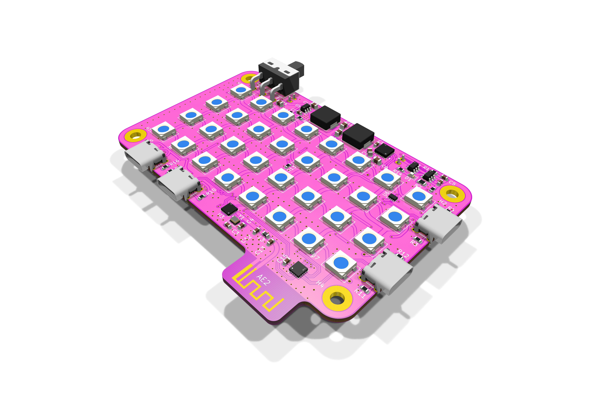
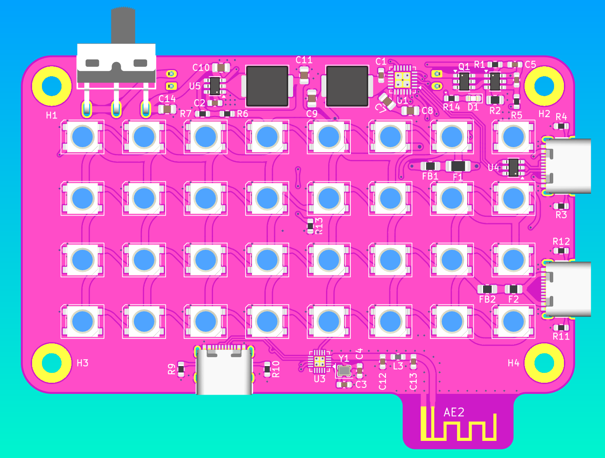
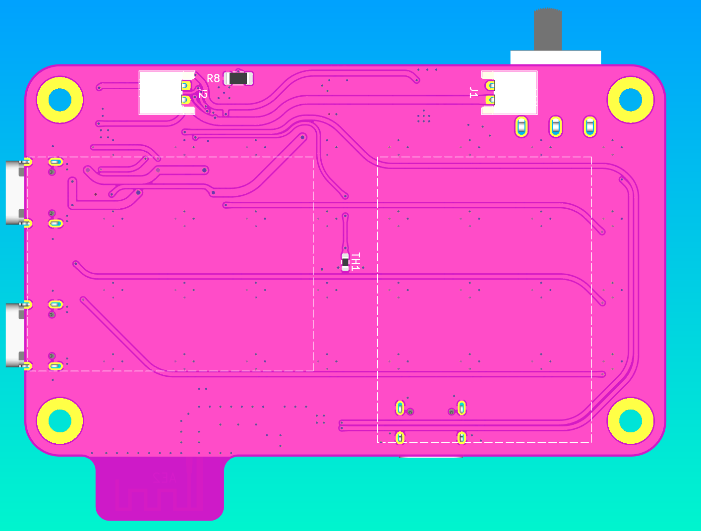
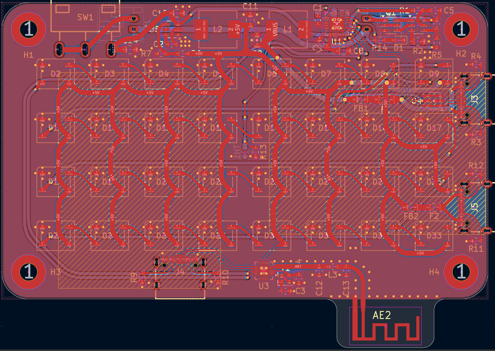

# Divine Light

CH572-powered RGB flashlight with BLE for remote control from phone. Uses SK6812s for high brightness and 2 LiPos for portable usage. Provides charging port and one reverse charging port (acts as power bank).

## PCB

## BOM

| Description | Quantity | Part # | Unit price | Extended Price USD | Product Link |
| :--- | :---: | :--- | :---: | :---: | :--- |
| Lithium Battery SOT-23-6 Battery Management | 5 | HY2120-CB | 0.251 | 1.26 | https://www.lcsc.com/product-detail/C116509.html |
| Battery Charging IC Battery Balancing IC Lithium-ion/Polymer VQFN-24-EP(4x4) | 2 | IP2326 | 0.6377 | 1.28 | https://www.lcsc.com/product-detail/C2832094.html |
| N-Channel Array 20V 6A 1.5W Surface Mount SOT-23-6L | 10 | FS8205A | 0.058 | 0.58 | https://www.lcsc.com/product-detail/C908265.html |
| 125mW 330Ω 150V Thick Film Resistor ±100ppm/°C ±1% 0805 Chip Resistor - Surface Mount RoHS | 100 | RC0805FR-07330RL | 0.0061 | 0.61 | https://www.lcsc.com/product-detail/C105878.html |
| 22uF ±20% 25V Ceramic Capacitor X5R 0805 | 30 | CL21A226MAYNNNE | 0.1078 | 3.23 | https://www.lcsc.com/product-detail/C602037.html |
| 10uF ±20% 10V Ceramic Capacitor X5R 0603 | 20 | CL10A106MP8NNNC | 0.0173 | 0.35 | https://www.lcsc.com/product-detail/C85713.html |
| Step-down type 600kHz Adjustable 2.5A SOT-23-6 Voltage Regulators - DC DC Switching Regulators | 5 | TP6327GS6-A | 0.3619 | 1.81 | https://www.lcsc.com/product-detail/C2901328.html |
| SMD-4P, 5.4x5mm LED Addressable, Specialty RoHS | 50 | SK6812 | 0.0726 | 3.63 | https://www.lcsc.com/product-detail/C5378720.html |
| 125mW 2kΩ 150V Thin Film Resistor ±50ppm/°C ±0.1% 0805 Chip Resistor - Surface Mount RoHS | 10 | RT0805BRE072KL | 0.0443 | 0.44 | https://www.lcsc.com/product-detail/C706274.html |
| 9.5A 2.2uH ±20% 15mΩ 10A Molded inductor SMD, 7x6.6mm Fixed Inductors RoHS | 10 | APH0630T2R2M | 0.0817 | 0.82 | https://www.lcsc.com/product-detail/C5349701.html |
| RES 180kΩ ±1% 250mW 1206 | 50 | 1206W4F1803T5E | 0.0145 | 0.725 | https://www.lcsc.com/product-detail/C17923.html |
| 5.1kΩ ±1% 100mW 0603 Thick Film Resistor | 100 | FRC0603F5101TS | 0.0015 | 0.15 | https://www.lcsc.com/product-detail/C2907044.html |
| USB-C (USB TYPE-C) Receptacle Connector 16 Position Surface Mount, Right Angle | 20 | TYPE-C 16PIN 2MD(073) | 0.0718 | 1.44 | https://www.lcsc.com/product-detail/C2765186.html |
| 100nF ±10% 50V Ceramic Capacitor X7R 0603 | 100 | CL10B104KB8NNNC | 0.0072 | 0.72 | https://www.lcsc.com/product-detail/C1591.html |
| 56kΩ ±1% 100mW 0603 Thick Film Resistor | 100 | FRC0603F5602TS | 0.0018 | 0.18 | https://www.lcsc.com/product-detail/C2907053.html |
| 100mW 10kΩ 75V Thick Film Resistor ±100ppm/°C ±1% 0603 Chip Resistor - Surface Mount RoHS | 100 | RC0603FR-0710KL | 0.0027 | 0.27 | https://www.lcsc.com/product-detail/C98220.html |
| NTC Thermistor 100kΩ Surface Mount 0603 | 50 | CMFA104J3950HANT | 0.0165 | 0.83 | https://www.lcsc.com/product-detail/C338607.html |
| 82kΩ ±1% 100mW 0603 Thick Film Resistor | 100 | FRC0603F8202TS | 0.0016 | 0.16 | https://www.lcsc.com/product-detail/C2907072.html |
| Purple LED Indication - Discrete 0603 | 50 | XL-1608UVC-04 | 0.0122 | 0.61 | https://www.lcsc.com/product-detail/C7371898.html |
| RISC-V 32 Bit 100MHz QFN-20-EP(3x3) Microcontrollers | 10 | CH572D | 0.312 | 3.12 | https://www.lcsc.com/product-detail/C46597863.html |
| 8pF 50V Ceramic Capacitor NP0 0603 | 100 | CC0603CRNPO9BN8R0 | 0.0066 | 0.66 | https://www.lcsc.com/product-detail/C327316.html |
| Slide Switch SPDT 2A @ 125V Through Hole, Right Angle Rectangular Columnar 12.7mm | 5 | SS12D10G6-WJ | 0.2314 | 1.16 | https://www.lcsc.com/product-detail/C7431059.html |
| 100mW 0Ω 75V Thick Film Resistor ±400ppm/°C ±1% 0603 Chip Resistor - Surface Mount | 100 | FRC0603F0000TS | 0.0015 | 0.15 | https://www.lcsc.com/product-detail/C2906974.html |
| Connector Header 2 position 2mm Pitch 2A Right Angle -25°C~+85°C | 20 | S2B-PH-K-S(LF)(SN) | 0.04 | 0.80 | https://www.lcsc.com/product-detail/C173752.html |
| 74mΩ 2 SOT-583 OR Controllers, Ideal Diodes RoHS | 1 | LM66200DRLR | 0.4213 | 0.4213 | https://www.lcsc.com/product-detail/C3235556.html |
| 4.7uF ±10% 10V Ceramic Capacitor X5R 0603 | 50 | CL10A475KP8NNNC | 0.0128 | 0.64 | https://www.lcsc.com/product-detail/C1705.html |
| 4 480Mbps USB 2.0 QFN-16(3x3) Interface Controllers RoHS | 1 | CH334P | 0.4073 | 0.4073 | https://www.lcsc.com/product-detail/C5373042.html |
| 300kΩ ±1% 250mW 1206 Thick Film Resistor | 100 | FRC1206F3003TS | 0.004 | 0.40 | https://www.lcsc.com/product-detail/C2933671.html |
| LCSC Shipping | 1 | LCSC Shipping | 12.38 | 12.38 | https://www.lcsc.com/ |
| PCB | 1 | PCB | 2 | 2.00 | https://jlcpcb.com/ |
| Stencil | 1 | Stencil | 3.1 | 3.10 | https://jlcpcb.com/ |
| JLCPCB Shipping | 1 | JLCPCB Shipping | 10.12 | 10.12 | https://jlcpcb.com/ |
| 103040 LiPo batteries | 2 | 103040 | 3.97 | 7.94 | https://ydlbattery.com/en-ca/products/3-7v-1200mah-103040-lithium-polymer-ion-battery?variant=42093666959513 |
| YDL Shipping | 1 | YDL Shipping | 6.98 | 6.98 | https://ydlbattery.com/en-ca |
| | | **Total:** | | **69.37** | |

## End notes

Made with <3 by @tobycm